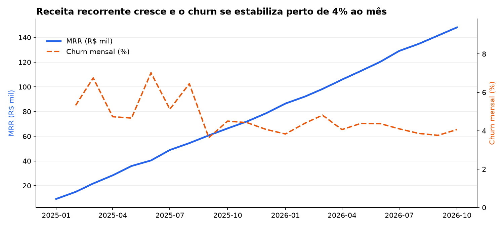
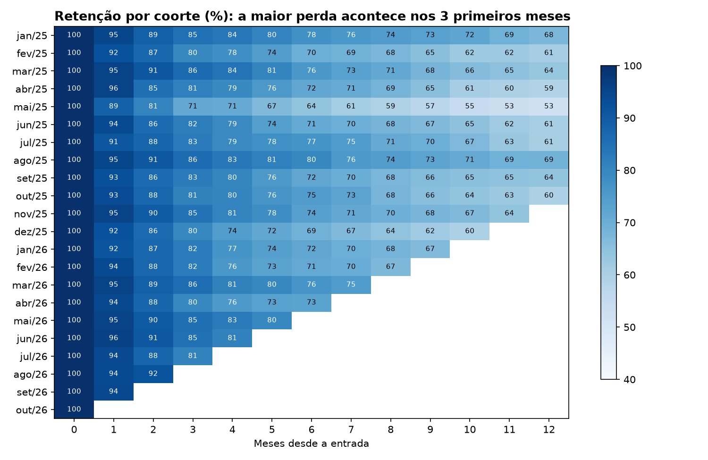
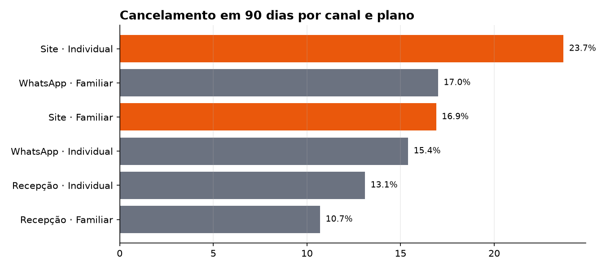
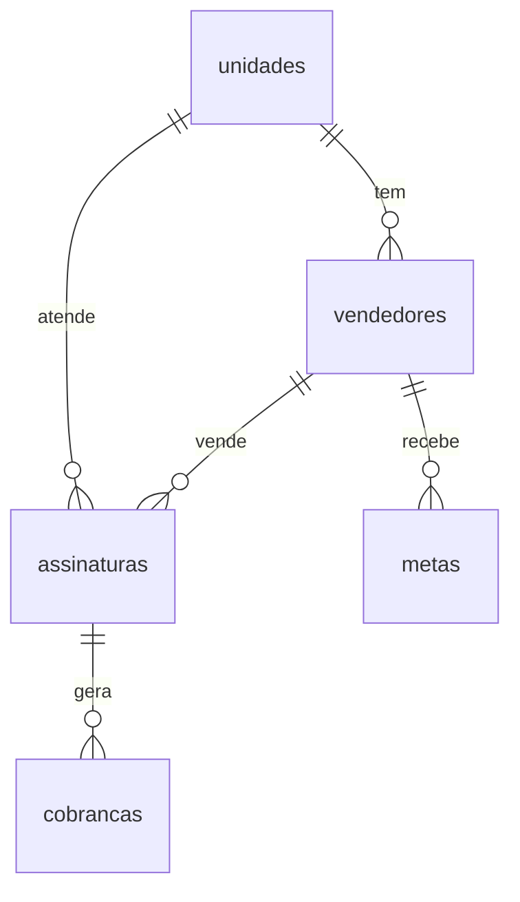

# 📈 Análise de Assinaturas em Saúde — SQL + Python

Projeto de portfólio que reproduz, com **dados 100% fictícios**, o tipo de análise que faço no dia a dia com planos de assinatura na área da saúde: crescimento da carteira, churn, retenção por coorte, inadimplência e ranking de vendas × meta.

> Os dados são gerados por `gerar_dados.py` com semente fixa. Nenhuma informação real de empresa, cliente ou colaborador é usada.

## Perguntas de negócio

1. Como evoluem a carteira ativa e a receita recorrente (MRR) mês a mês?
2. Qual é o churn mensal e ele está melhorando?
3. Em que momento da vida do cliente acontece a maior perda? *(coortes)*
4. Quais canais de venda trazem clientes que cancelam mais cedo?
5. Quanto do faturamento fica inadimplente?
6. Quem são os 5 melhores vendedores do mês em relação à meta?

## Principais resultados

| Indicador (out/2026) | Valor |
|---|---|
| Assinaturas ativas | **3.008** |
| MRR | **R$ 148,1 mil** |
| Churn mensal | **4,1%** (média do período: 4,7%) |
| Retenção média em 3 meses | **82%** |
| Retenção média em 12 meses | **62%** |
| Inadimplência > 30 dias | **~6%** do faturado |



**A maior perda acontece nos 3 primeiros meses.** Depois disso a curva de retenção fica bem mais estável. Ações de onboarding (boas-vindas, primeiro agendamento) tendem a ter mais retorno do que campanhas de retenção para clientes antigos.



**Vendas pelo site cancelam quase 2× mais em 90 dias do que vendas na recepção** (23,7% × 13,1% no plano Individual). O plano Familiar retém melhor em todos os canais.



## Estrutura

```
├── gerar_dados.py          # cria dados/assinaturas.db (SQLite) com dados fictícios
├── analise.py              # roda as consultas, salva CSVs e gráficos
├── sql/
│   ├── 01_kpis_mensais.sql          # ativas, novas, cancelamentos, churn, MRR
│   ├── 02_coorte_retencao.sql       # matriz de retenção por coorte
│   ├── 03_churn_por_canal_plano.sql # churn em 90 dias por canal × plano
│   ├── 04_inadimplencia.sql         # faturado × inadimplente por competência
│   └── 05_ranking_vendedores.sql    # vendas × meta com ROW_NUMBER (Top 5)
├── resultados/             # saídas em CSV
└── img/                    # gráficos
```

### Modelo de dados



## Como rodar

```bash
pip install -r requirements.txt
python gerar_dados.py
python analise.py
```

## Técnicas usadas

- **SQL:** CTEs (inclusive recursivas para gerar calendário), `CROSS JOIN` com calendário para fotografar a carteira mês a mês, funções de janela (`ROW_NUMBER`, `SUM OVER`), agregações condicionais.
- **Python:** `sqlite3`, `pandas` e `matplotlib`.
- **De SQLite para BigQuery:** as consultas usam SQL padrão; os comentários em cada arquivo indicam o equivalente no BigQuery (`GENERATE_DATE_ARRAY`, `DATE_ADD`, `DATE_DIFF`).

## Próximos passos

- [ ] Versão das consultas no BigQuery com dataset público
- [ ] Painel no Looker Studio com os mesmos indicadores
- [ ] Modelo simples de propensão a churn

---

Feito por [Clevilson](https://github.com/Clevilson) · Assistente de Dados
